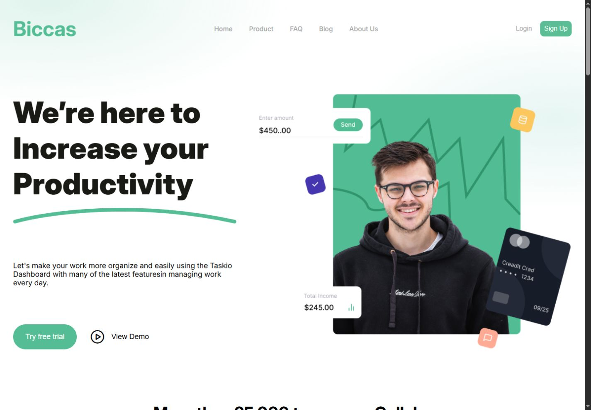
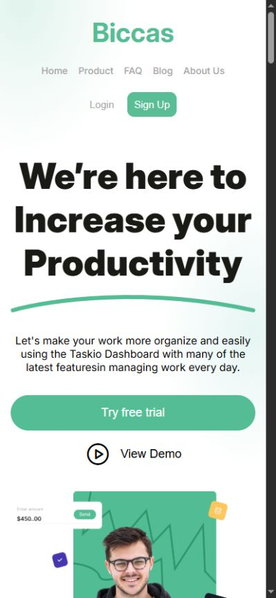

<h1 align="center">Biccas</h1>

<p align="center">
  <strong>Landing page desenvolvida para praticar HTML e CSS.</strong>
</p>

<p align="center">
  
  
  
</p>

<p align="center">
 <a href="#-sobre-o-projeto">Sobre</a> •
 <a href="#-layout">Layout</a> •
 <a href="#-tecnologias-utilizadas">Tecnologias</a> •
 <a href="#-instalação-e-uso">Instalação</a>
</p>

<h4 align="center">
	🚧  Projeto concluído 🚀 🚧
</h4>

## 💻 Sobre o projeto

Biccas é uma landing page fictícia desenvolvida com o objetivo de praticar HTML e CSS.

O projeto foi feito para treinar estruturação de páginas, responsividade, uso de imagens, espaçamentos, tipografia e organização de classes no CSS.

> Os botões, links de navegação e formulários são apenas visuais. O projeto não possui JavaScript, backend ou funcionalidades reais.

## 🎨 Layout

### Desktop

<p align="left">
  
</p>

### Mobile

<p align="left">
  
</p>

## 🔨 Tecnologias utilizadas

As seguintes ferramentas foram usadas na construção do projeto:

- **HTML5**
- **CSS3**
- **Flexbox**
- **CSS Grid**
- **Media Queries**
- **Google Fonts**
- **Phosphor Icons**

## 🚀 Instalação e uso

```bash
# Clone o repositório
git clone https://github.com/davysonwss/biccas.git

# Acesse a pasta do projeto
cd biccas

# Abra o arquivo index.html no navegador
```

---

Feito com 💜 por [Davyson Santos](https://github.com/davysonwss)
